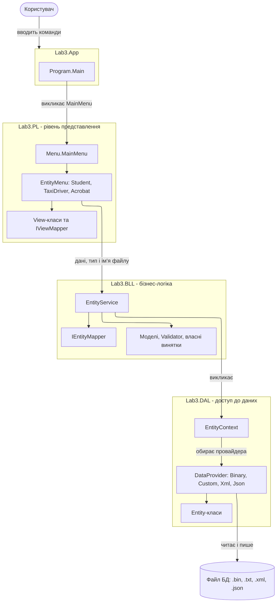
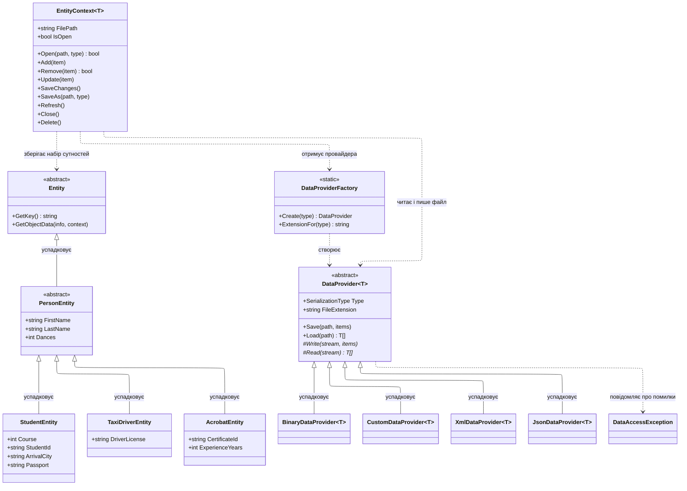
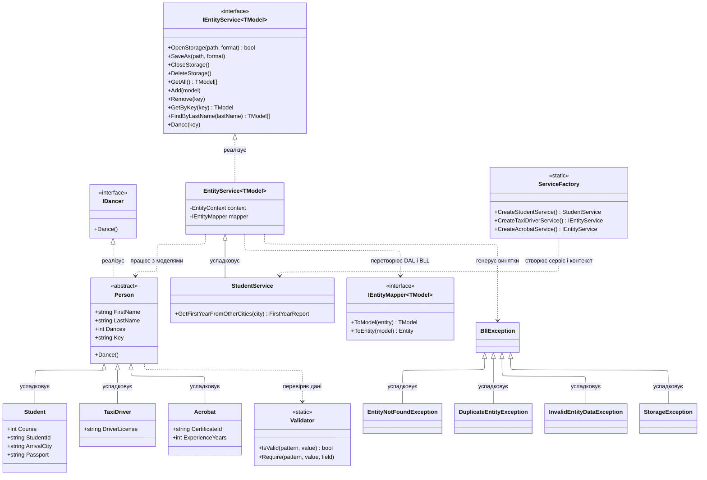
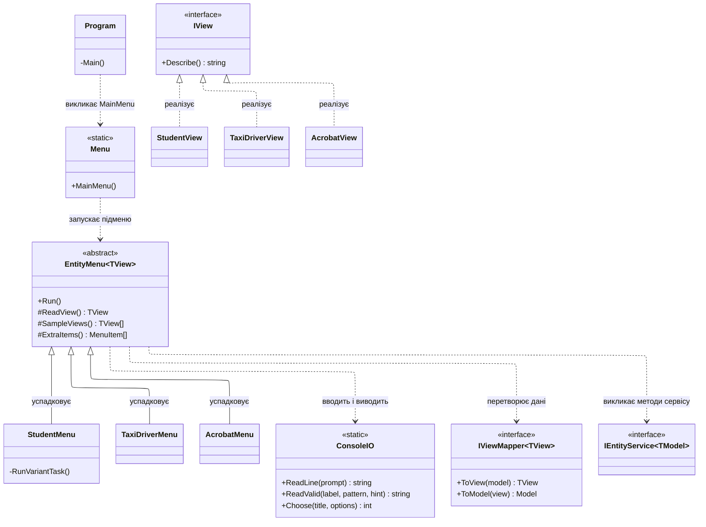
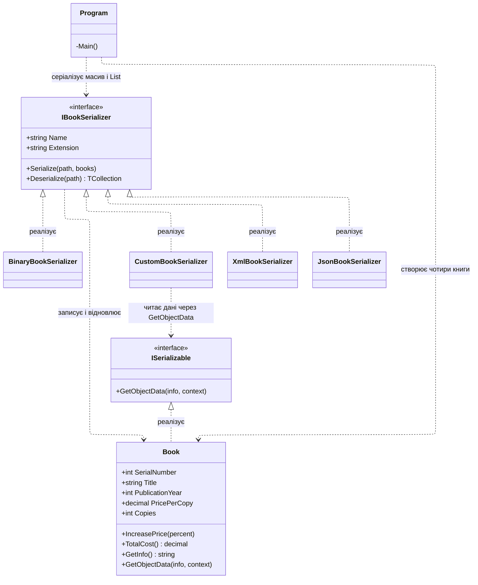
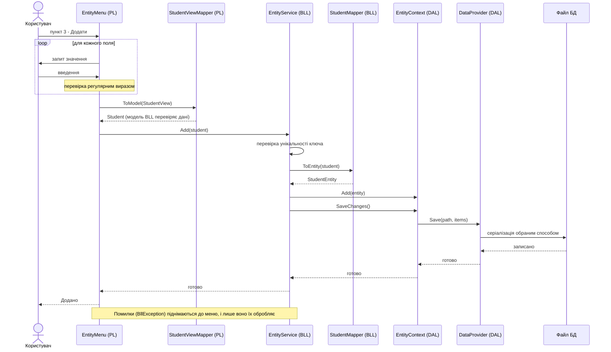
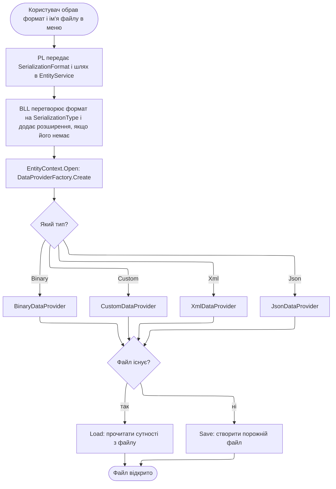
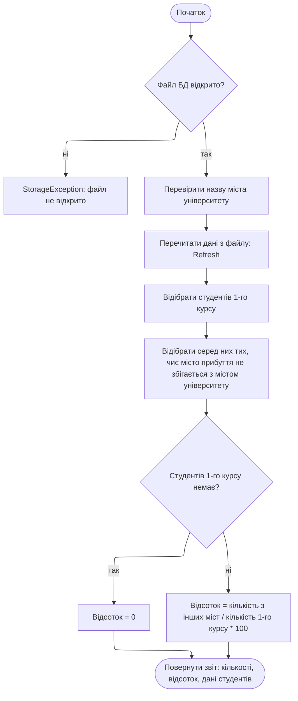

# Схеми до лабораторної роботи 3.3 - варіант 2

## 1. Архітектура рішення

## 2. Діаграми класів

### 2.1. Рівень DAL: сутності, контекст, провайдери

### 2.2. Рівень BLL: моделі, сервіси, винятки

### 2.3. Рівень PL і точка входу

### 2.4. Частина 1: клас Book та серіалізатори

## 3. Взаємодія об'єктів: додавання студента

## 4. Вибір провайдера за типом серіалізації

## 5. Завдання варіанта: відсоток студентів 1-го курсу з інших міст

